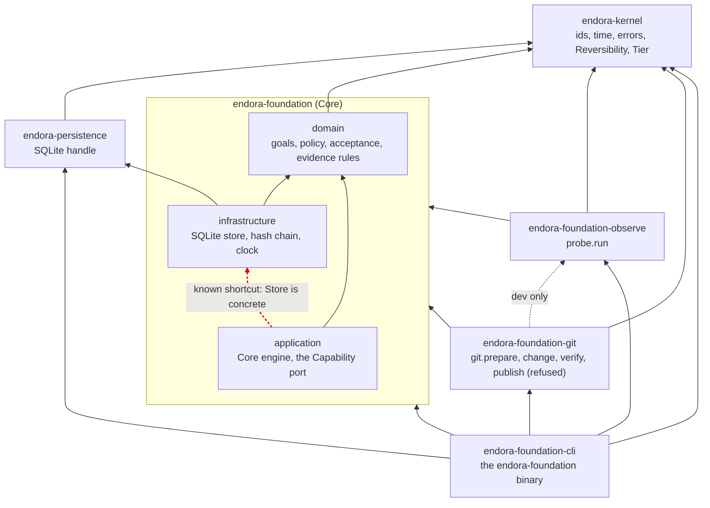

Status: CURRENT · the foundation; its interfaces are rated in docs/foundation/STABILITY.md (7 FROZEN, 12 EXPERIMENTAL)

# Endora

<!-- INTERIM-NOTICE:BEGIN delete this whole block, and every line marked INTERIM-NOTICE, once the foundation is merged into main -->
> **Interim notice (15 Nov 2026).** The foundation (Core, its capabilities, the `endora-foundation`
> command and these pages) currently lives on the branch `docs/developer-docs-v1`. The default branch
> `main` still holds the earlier HQ product until the foundation is merged, so a clone of `main` does
> not contain the code these pages describe. **Until then, check out `docs/developer-docs-v1` and
> branch from it, not from `main`.**
<!-- INTERIM-NOTICE:END -->

**Endora is a local-first foundation for autonomous work. It holds goals, authorizes execution,
records evidence, and coordinates replaceable capabilities without tying the system to a particular
model, vendor or agent framework.**

You give it a goal and the rule for when the goal is met. It decides, from policy you wrote, what may
run, runs it through a **capability** (a small piece of code that touches the world), writes down what
happened before and after, and counts the work as done only when the criteria are met and an
authorized person accepts. If the process dies halfway, it picks up from what it wrote down. It
knows no language model and needs none; a model can sit behind a capability, and nothing here depends
on which.

**Status labels** used in these pages: `CURRENT` (matches the code), `EXPERIMENTAL` (works, may
change), `LEGACY` (the earlier HQ product or design, true for its time), `UNSUPPORTED` (known not to
work or not to be relied on), `PLANNED` (not built; never described as if it were).
**Today this is one maintainer's project with one release line**; interfaces are rated individually in
[STABILITY.md](docs/foundation/STABILITY.md).

## What works today

| What | Status | Notes |
|---|---|---|
| Goals, routines, work items, criteria, owner acceptance | CURRENT (interfaces FROZEN) | `docs/start.md` walks through it |
| Authority: bands, tiers, default deny, stop switch, spend caps in micro-USD | CURRENT (owner decision commands EXPERIMENTAL) | [trust and spend](docs/trust-and-spend.md) |
| Evidence: an intent before each call and a result after, append-only through the engine | CURRENT; the hash chain on top is EXPERIMENTAL | detects edits; not proof of whole-database integrity |
| Crash recovery: items a dead process left running are settled from the database file | CURRENT | single runner process only |
| Observe capability: tcp, http and command probes you write in a config file | CURRENT | no code needed |
| Git capability: a code change by a configured agent, verified on a clean copy, then waits for you | EXPERIMENTAL | `git.publish` is always refused: nothing here publishes |
| Claude Code CLI as the agent of the git capability | EXPERIMENTAL | macOS only; costs real money; the dollar cap is unverified |
| Confinement of untrusted agents: macOS `sandbox-exec`, Docker per call on Linux | macOS scripted profile FROZEN; the rest EXPERIMENTAL | Linux `bwrap` is written but not verified on any host tested |
| A real agent under the Docker backend | UNSUPPORTED | no network in the container; credential handling is not designed for it |
| Retiring a goal or a routine | UNSUPPORTED | not implemented: no command closes a goal or deletes a routine; the stop switch halts everything; [Known limits](docs/foundation/README.md#known-limits) |
| Replacing a lost owner token | UNSUPPORTED | not implemented: keep a second copy of the token file with the same care as the database |
| A per-call owner approval (`approve-call`) | PLANNED | does not exist; an outward-reversible call is refused, not asked about |
| Container image for the runner | EXPERIMENTAL | built and healthchecked on one Linux host; not deployed as a service |

Not built, and not promised: a plugin loader, a wire protocol or schema for capabilities, a language
SDK, a conformance suite, a web console for the foundation. A capability today is a Rust type
compiled into a binary ([the contract, exactly](docs/architecture.md#what-an-integration-must-satisfy-today)).

## Run it

Needs Rust 1.87 or newer, `sh`, and `python3` or `perl` (for a throwaway local listener). No model,
no network beyond `127.0.0.1`, no account.

```sh
cargo build -p endora-foundation-cli                          # builds target/debug/endora-foundation
sh examples/a-observe/run.sh                                  # runs example A in a temp directory; prints "run.sh OK"
sh scripts/foundation-smoke.sh target/debug/endora-foundation # an end-to-end smoke test; prints "smoke OK"
```

Then do it by hand, one command at a time, with every flag explained: [docs/start.md](docs/start.md).

## Where to go

| You want to | Go to | Audience |
|---|---|---|
| **Use** it: run it, write goals and probes, back it up, keep it running | [docs/start.md](docs/start.md), [docs/foundation/README.md](docs/foundation/README.md), [docs/operate.md](docs/operate.md) | someone with Rust and a terminal |
| **Build** on it: add a capability, integrate a tool | [docs/architecture.md](docs/architecture.md#where-does-my-code-go), [terminology](docs/terminology.md) | a Rust developer |
| **Contribute**: change Core, add docs, review | [CONTRIBUTING.md](CONTRIBUTING.md), [docs/architecture.md](docs/architecture.md) | a contributor |

All pages by audience: [docs/README.md](docs/README.md).

## Architecture

Endora is a responsibility-oriented modular monolith using established Domain-Driven Design and
Clean Architecture principles. Core owns durable work, authority and evidence; capabilities own
their implementations and integrations. Dependencies point inward, keeping the domain independent of
infrastructure and vendors.

The crates of the foundation, as they are (checked with `cargo metadata`; a solid arrow is a normal
dependency, a dotted one is development-only):



Capabilities depend on Core's crate, never the other way round; Core does not name any capability.
Core's storage is a concrete SQLite store, not behind a port: a known shortcut, listed with two others
in [Known deviations](docs/architecture.md#known-deviations). Internally the project calls this
discipline ROCA ([ADR 0050](docs/adr/0050-the-shape-of-the-system.md)); the current statement of it
is [ADR 0150](docs/adr/0150-current-architecture-the-foundation.md) (Proposed).

## Legacy

Before the foundation this repository was **Endora HQ**, a team of AI agents run by a model-backed
node with a web console. That code and its documents are kept, labelled `LEGACY`, and are not the
foundation: [docs/legacy/](docs/legacy/README.md). The former front page is
[docs/legacy/README-HQ.md](docs/legacy/README-HQ.md).

## Contributing and licence

Read [CONTRIBUTING.md](CONTRIBUTING.md), the [Code of Conduct](CODE_OF_CONDUCT.md) and
[SECURITY.md](SECURITY.md). **AI-assisted contributions must be flagged as such** in the PR.
Branch from `docs/developer-docs-v1` for now (see the interim notice at the top; `main` after the merge). <!-- INTERIM-NOTICE -->
The public history holds the foundation as one squashed commit.

Licensed under [Apache-2.0](LICENSE). Copyright 2026 Endora contributors. See [NOTICE](NOTICE).
