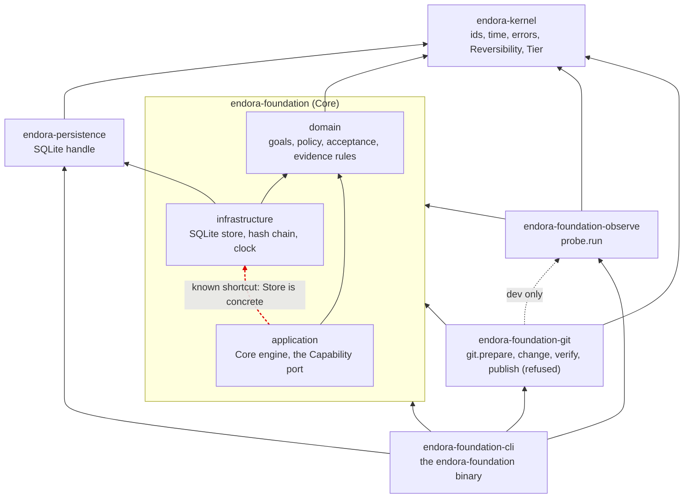

Status: CURRENT · the foundation's architecture; the HQ-era text after the divider near the end is LEGACY

# Architecture

*Audience: contributors and developers building on the foundation.* The decision record is
[ADR 0150](adr/0150-current-architecture-the-foundation.md) (Proposed); this page is the working
description and the evidence.

Endora is a responsibility-oriented modular monolith using established Domain-Driven Design and Clean
Architecture principles. Core owns durable work, authority and evidence; capabilities own their
implementations and integrations. Dependencies point inward, keeping the domain independent of
infrastructure and vendors. The structure follows responsibility: it is not a template. Core uses
`domain` / `application` / `infrastructure` modules because it owns durable state, policy, execution
and recovery; a small capability can be one Rust module; a bounded context is not a crate.

## The six responsibilities, as the code names them

`domains/foundation/src/lib.rs` says "Six verbs and nothing else": **hold**, **decide**, **run**,
**record**, **require**, **recover**. Where each lives:

| Verb | Code |
|---|---|
| hold | `domain/hold.rs` (goals, items, `Fact`, `FactValue`); `Core::add_goal`, `add_item`, `add_routine`, `fire_due` |
| decide | `domain/decide.rs` (`PolicyRow`, the decision table), `domain/contract.rs` (`CallSpec`, `Budget`); `Core::grant`, `stop`, `call` |
| run | `application/ports.rs` (`Capability`, the one port); `Core::call` is the only path to a capability |
| record | `domain/evidence.rs`, `infrastructure/chain.rs` (hash chain); an intent before the call, a result after |
| require | `domain/accept.rs`; `Core::accept`, `decline`, `confirm_criterion`, `settle_by_policy` |
| recover | `Core::recover_interrupted`, called at the start of `run-due` |

## The crates as they are

Checked with `cargo metadata` (normal edges; the foundation crates share only `endora-kernel` and
`endora-persistence` with the LEGACY HQ crates, and no HQ crate depends on a foundation crate).



The dashed red edge points outward and contradicts "dependencies point inward": see
[Known deviations](#known-deviations). Capabilities depend on Core's crate, not the reverse. The
`app/foundation` crate is the composition root: it parses the command line and the config file and
wires the capabilities in (`app/foundation/src/main.rs`).

## What an integration must satisfy today

Nothing about Endora's internal structure is imposed on an integration. What it must satisfy is exactly
this, and nothing more is specified:

- **The contract: a Rust trait.** `Capability` (`domains/foundation/src/application/ports.rs`):
  `offers()` returns one `CallSpec` per call, with an honest band, tier, maximum cost, seconds and turns,
  typed input and fact fields and a budget mode; `call(name, input)` (or `call_budgeted`, which also
  receives the granted `Budget`) returns a `CallOutput` (cost in micro-USD, facts, result text, evidence
  text, optional profile) or a `CallFailure`. Core calls only through that trait and checks the inputs
  and facts against the declaration. The trait is **EXPERIMENTAL** (the "call spec" row of
  [STABILITY.md](foundation/STABILITY.md)): building on it today means building on an interface that
  may change.
- **Security expectations.** An untrusted executor runs confined (macOS `sandbox-exec`, or Docker per
  call on Linux). The boundary is isolation; your declaration is policy metadata that Core trusts. A fact
  must come from something your code observed, never from text an agent or a remote wrote; a word-valued
  fact must be one of the closed list your spec declares.
- **Tests.** A scripted stand-in: no model, no network, no paid API.

**Not specified:** no wire protocol, no schema file for `CallSpec` or `CallOutput`, no process or RPC
contract, no plugin loader, no language SDK, no conformance suite, no published crate or version
policy. There is no way to register a capability without compiling it into a Rust binary that depends
on `endora-foundation`. A tool written in another language can be reached today only by (a) a
`probe NAME command ...` config line (read-only; the fact is the exit code), (b) the git capability's
agent command (any executable, run confined), or (c) a Rust adapter that starts it. This is not a plugin
system.

## Where does my code go?

Stop at the first yes.

1. **A config line.** An existing capability already does it (a probe of kind `tcp`, `http` or
   `command`). Write a line in the config file. No code, no crate.
2. **One module.** A small capability (a call or a few, little state, no heavy dependencies) is one Rust
   module implementing `Capability`, in your own crate or binary. No `domain` / `application` /
   `infrastructure` folders are required: responsibility, not a template, determines structure.
3. **An adapter on the existing contract.** You expose an existing tool, service or agent runtime: write
   an adapter (a module or a small crate) that implements `Capability` and keeps every IO detail inside
   it. The tool can be in any language if the adapter owns the process, file or network boundary to it.
4. **A new crate.** Only for its own dependencies, release rhythm, owner or reuse, as `foundation-git`
   is (2,789 lines in `src`, confinement code, its own `serde_json` dependency, its own security
   surface). A crate is a packaging decision, not a design status. `foundation-observe` is 470 lines.
5. **A new bounded context.** Only where the thing owns domain concepts and behaviour with their own
   invariants and state (Core itself: goals, authority, evidence, recovery). A bounded context is not a
   crate: it can be a module or a folder, and a crate can hold part of one or several small ones. If it
   only calls the world on Core's behalf, it is a capability (1 to 4).

Layers: `domain` / `application` / `infrastructure` are justified for Core only. Neither capability
follows the template, and both pass their tests. Other responsibilities: durable goal, work and evidence
rules, authority tables, spend rules and recovery go in Core (`domains/foundation/src/domain`);
anything that touches the world is a capability; process and command-line wiring and the config grammar
go in `app/foundation`; shared ids, time and errors go in `shared/kernel` only if genuinely
cross-cutting.

## The evidence for this architecture: the Git capability

The architecture claims that a capability can be added and hardened without changing Core. The test of
that claim is the git capability (`domains/foundation-git`), added after the observe capability, then
hardened with fresh-copy acceptance, confinement, a Docker backend and a real agent executor. Exactly
what holds:

**Holds (structural, checkable in this public repository).** Core's source and tests do not reference
the capability crates:

```text
$ grep -rnE "foundation[_-](git|observe)" domains/foundation
$ echo $?
1
```

(no match; exit 1). Core's own dependencies are `endora-kernel`, `endora-persistence`, `rusqlite` and
`sha2` (`domains/foundation/Cargo.toml`); `serde_json` is the git crate's own. Core's tests use scripted
stand-ins (`registration.rs`, `budget.rs`, `micro_usd.rs`). One test file, `call_routing.rs`, gives a
stand-in the call name `probe.run` to test routing; that is a name, not a dependency.

**Holds (from commit history, not checkable in the public repository).** Adding the capability changed
files only under `domains/foundation-git` (5 files; Core source 0, Core tests 0, CLI 0). Ten later commits
that hardened it changed only that directory plus three one-line command-line config edits; none changed
a Core source file for the capability's own logic. The commits are in the project's private history. **The
public history has one squashed commit** holding the foundation, so these counts cannot be reproduced
from it.

**Does not hold: the contract did not stay still.** The *capability contract* that Core exposes was
widened six times while the git capability was built, in commits that also touched the git crate:

| Widening (commit subject, paraphrased) | Core lines changed: domain / application / infrastructure |
|---|---|
| registration rejects duplicate names, empty names and undeclared bands | 0 / 34 / 0 |
| a call declares a maximum cost and returns the actual cost | 25 / 95 / 49 |
| a check reads a named fact, never text | 93 / 30 / 41 |
| declared call shapes and executor-declared spend enforcement (`Enforced`, `call_budgeted`, `Budget`) | 338 / 195 / 0 |
| typed actors, owner token and `OwnerProof` | 252 / 447 / 127 |
| micro-USD; spec-declared seconds and turns; a structured `profile` column (schema 6 and 7) | 73 / 137 / 166 |

That is about 780 changed lines in Core's `domain` alone (781 by the table). The changes came from what the
git capability and the real executor taught (cost, facts, budgets, turns, profile) and from independent
reviews (authority, typed actors). So the accurate claim is: **the git capability, with confinement,
Docker and the real agent, was added and hardened without changing Core for the capability's own logic,
but the capability contract was widened six times under it, and today's Core domain is the result of
those widenings.** The first version of the contract was not sufficient for the second capability's
real needs. This is one capability and one maintainer; it is evidence, not proof, that a third
capability would need no change.

## Known deviations

Documented, not fixed (no code change and no new abstraction in this increment):

1. **No storage port.** `application` imports the concrete `Store` and `ManualClock` from
   `infrastructure` (`application/core.rs`: `use crate::infrastructure::{ChainReport, ManualClock, Store}`;
   `application/owner.rs`: `use crate::infrastructure::{hex, os_random}`). The only port is `Capability`.
   `ManualClock`, a test clock, is exported from `infrastructure` and used by `Core::in_memory`. The
   early design records said storage is reached through application-defined ports; it is not.
2. **Capabilities depend on Core's whole crate**, including its SQLite store, not on a narrow contract
   crate.
3. **Domain purity is by convention.** Every file in `domain/` imports only `endora_kernel`, `std` and its sibling
   domain modules, but `domain`, `application` and `infrastructure` are modules of one crate whose `Cargo.toml`
   lists `rusqlite` and `sha2`, so the compiler cannot enforce it and no test does.

If a second store, a fake store or another SQLite replacement is needed, extract a port then.

---

## LEGACY: the HQ architecture (original text, kept unchanged below)

**Status: LEGACY.** Everything below describes Endora HQ and the node, the earlier product. In it, "the
node is the trust boundary" is an HQ-era statement: in the foundation the boundary is isolation of
untrusted executors, not any process of Core's ([trust and spend](trust-and-spend.md)). The text was
last reconciled with the code on 2026-10-20 and is not updated.

## HQ architecture (LEGACY)

> Describes the shape of the system and the boundaries it enforces. Implementation
> grows one vertical slice at a time. Last reconciled with the code 2026-10-20
> (ADR 0136: Endora is HQ, and the butler's chat is retired).

## Overview

Accepted collaboration target ([ADR 0138](adr/0138-one-conversation-and-assistance-lifecycle.md)):
one conversation/assistance lifecycle replaces legacy task-thread consultation
execution, while the existing Work UI retains readable historical conversations
and task/run links. The old application consultation scheduler and record-answer
fallback and their legacy storage writers have been removed. Context/wake
cleanup, migration rehearsal and live cutover remain required before calling
this complete.
The migration boundary now includes HQ `/v2/team/mcp` and the node's team-only
`/team-gateway/v2/mcp`, which select canonical assistance semantics. Worker/runner
defaults use v2 and reject stale configured routes. The v1 worker endpoint
authenticates first, then returns HTTP 410 with the supported route.
Before publishing HTTP, HQ startup cancels legacy questions, stops and settles
their expert runs, preserving ordinary task work and canonical assistance.
Cleanup failure aborts startup and remains recoverable. Task-linked v2 admission checks
the authorized conversation against trusted task/project context, including
transactional revalidation and original-task replay identity. Atomic content/source
readers and smaller source-classified ordinary task briefings are implemented.
The owner's messaging switch selects this input policy for ordinary developer
and researcher work; there is no separate migration selector. Messaging-disabled
work retains its world/notebook context. Specialized task briefings retain their
authority responsibilities and conservative input guard. Both contexts use the
same canonical peer policy; neither selects legacy consultation execution.
Classified context retains owner notes near the top, actual management routing
and the latest indexed handover, inheriting that note's original source tier.
This is not a completed production cutover.

Protocol tool directories and familiar call names use the same canonical policy.
The worker's first-line identity contract is preserved; version guidance follows
the briefing and restart notices remain last. The automatic claim acknowledgment
contains only the checked task ID and does not invent a private input or clear
existing private inputs. Automatic task recovery waits while that task's accepted
help or result-verification turn remains pending, then resumes without completing
the task or changing its owner. These checks use indexed canonical metadata,
independent of retained question/answer bodies.

Task-thread posts and worker final words remain readable reporting. Their member
mentions dispatch no peer work; only explicit owner-authored posts may schedule
mentions. Real management question/reply and owner-decision pathways retain their
own authority responsibilities, including replies that name their requester.

The associated requester-result turn can retain one final finding with its
assistance request. Current scope, source grants and input tiers are revalidated
atomically. It remains an attributed claim in Work and its request-page export,
with original run/source links; it does not complete or approve a task. Findings
survive raw transcript expiry and are purged with explicit owner conversation
deletion. A durable finding prevents another model attempt after worker loss.

Retained task questions have a bounded owner-only projection through
`/v1/tasks/{id}/consultations`, proxied by the node into the existing Work task
inspector. Exact original IDs, project snapshots and answer-post associations
are retained; missing links remain unavailable. Reading history creates no
conversation permissions or work. This separates historical inspection from
the retired execution path. Production keeps the historical readers and bounded
startup cancellation, with no legacy admission/claim/answer/delivery writer API.

Endora is a **domain-first modular monolith**. A single authoritative backend —
the **node** — is the trust boundary. It holds all authority and the secrets. **Endora HQ**
(`app/hq`), the team of agents that does the home lab's work, is a separate service the node
fronts; every act a team turn takes crosses the node (ADR 0102). Clients (the web console, the
handheld, a CLI) are **thin and replaceable**, and reach the node only through a stable,
versioned protocol.

```text
        ┌─────────────────────────────────────────────┐
        │                 endora-node                  │
        │       (authoritative trust boundary)         │
        │                                              │
        │   Interface → Application → Domain           │
        │   Infrastructure → Application/Domain ports  │
        └───────────────▲──────────────────────────────┘
                        │  stable, versioned protocol
                        │  (HTTP + JSON, OpenAPI-described)
     ┌──────────────────┼───────────────────┐
     │                  │                    │
  web console      the handheld         endora-cli
 (HQ first)     (clients/terminal)    (thin client)
```

## The node is authoritative; clients are replaceable

The home-lab dashboard is a separate read projection in capabilities: fixed-route
adapters collect bounded Docker and media queue observations, and `/v1/homelab`
serves them to authenticated clients. Observations and credentials are not included
in model context or the model tool catalogue. See [ADR 0092](adr/0092-the-home-lab-is-a-server-owned-read-view.md).

- All state, policy, and decision-making live in the node. A client renders and
  requests; it never holds authority.
- Because clients are replaceable, no client technology is load-bearing. Endora
  must **survive changes in AI models, vendors, frameworks, and client
  technologies.** The protocol — not any UI — is the stable contract.

## Workspace layout — Responsibility-Oriented Clean Architecture (ROCA)

The design patterns in use are a **closed, named set** — see
[the pattern budget](patterns.md). A pattern not on that list needs an ADR that
also names what it retires.

The code is organized **by responsibility**, not by technical layer (ADR 0050).
Each bounded context is its own crate under `domains/`, owning its full
Clean-Architecture stack; cross-cutting primitives live in `shared/`; the
composition roots live in `app/`.

```text
app/         node (the trust boundary), hq, worker, runner, sound, cli — compose the contexts
domains/     one crate per bounded context, each layered internally:
             <context>/src/{domain, application, infrastructure[, interface]}
  platform         audit trail + event log
  capabilities     skills and their stances, the bridge, contracts' policy, egress guard, MCP
  team             Endora HQ's team core: goals, tasks, wakes, runs, the tick, the ledger
  sound            speakers, sources and wires (the sound hub's)
  mail             rules over a read-only mail copy, kept as a library (ADR 0136)
shared/      kernel (ids, time, errors, AutonomyLevel, Reversibility, tiers),
             persistence (Db handle, secrets at rest), protocol (the handheld's wire types)
```

The thin **orchestration layer** (`endora-application`) holds the use cases that compose
several contexts: the activity feed, and the owner's export and delete of Endora's record. The
butler's turn, its brief, research, the brain and the agenda loop that once lived here were
retired with the chat ([ADR 0136](adr/0136-endora-is-hq.md)); the work that outlives a request
is HQ's now. Contexts do not reach into each
other's internals; they collaborate through application-layer ports, and the
dependency graph is acyclic.

See [domain-map.md](domain-map.md) for what each context owns.

HQ's information conversations are also owned by `team` ([ADR 0137](adr/0137-addressed-conversations-and-bounded-assistance.md)).
The owner authorizes fixed project/participant scopes through the node. Existing live turns can
exchange bounded Internal information without creating tasks, wakes or model calls. Conversation
history is retained until explicit owner deletion; routine access uses indexed cursor pages and
deletion uses bounded batches. The owner inspects message and content-free operation pages in
HQ Work. The feature defaults off. Explicit assistance uses one bounded expert
and requester-result lifecycle, owner-granted original evidence and trusted
project charging. Ordinary consultation is a thin adapter to that lifecycle;
it has no task-thread queue or automatic historical-answer substitution.

## Layers within each context

Each bounded context is layered:

| Layer | Responsibility | May depend on |
| --- | --- | --- |
| **Domain** | Pure concepts and rules of the context. | The shared kernel only. |
| **Application** | Use cases; orchestrates the domain; defines ports. | Domain; other contexts' ports (for cross-context orchestration). |
| **Infrastructure** | Adapters that implement ports (DB, HTTP clients, model providers, OS). | Domain/Application *abstractions*; `shared/persistence`. |
| **Interface** | Delivery: the protocol surface, CLI, client-facing edges. | Application. |

### Allowed dependency directions

```text
Interface  →  Application  →  Domain
Infrastructure  →  Domain / Application abstractions
```

The **Domain layer must not depend on**: HTTP, databases, AI vendors, UI
frameworks, OS integrations, or model-specific concepts. This is enforced today:
each context's `domain` module imports only `shared/kernel`, which itself has zero
dependencies, and higher layers depend inward. See
[ADR&nbsp;0001](adr/0050-the-shape-of-the-system.md).

## The deterministic policy boundary around probabilistic models

AI models are reasoning components, not authorities. Around every model sits a
**deterministic boundary**:

```text
   model output (a proposal)
            │
            ▼
   ┌───────────────────────┐
   │  deterministic policy │  ← the enforcement boundary
   │     (capabilities)    │
   └──────────┬────────────┘
              │ authorized?              │ denied / escalate to human
              ▼                          ▼
        capability execution        no action
```

Models never call privileged capabilities directly. A model *proposes*;
deterministic policy code decides; capabilities execute only what policy
authorized. The language model is never the final enforcement boundary. See
[ADR&nbsp;0005](adr/0051-where-the-boundary-is.md) and
[constitution §3](constitution.md).

## Stable, versioned application protocol

- The node exposes a **versioned** protocol. Backward compatibility within a
  major version is a hard requirement so clients can evolve independently.
- Transport is **HTTP + JSON**, described by **OpenAPI**, with **server-sent
  events** for simple live updates. See
  [ADR&nbsp;0003](adr/0050-the-shape-of-the-system.md).
- **MCP is not the application protocol.** MCP may *later* expose selected Endora
  capabilities to external AI systems, but Endora's own clients speak the
  versioned HTTP/JSON protocol.

## Local-first deployment

- Endora runs on consumer hardware and prioritizes the majority of users over
  high-end or specialized systems.
- Targets: **macOS, Linux, Ubuntu Server, and Docker.**
- Cloud services (including cloud model providers) are **optional and
  replaceable** adapters behind the policy boundary.

## Persistence: SQLite first

Persistence starts with **SQLite** — a single-file, local, zero-operations
store that fits a local-first platform. Storage sits in the infrastructure layer
behind application-defined ports, so the engine can change later without
touching the domain. See [ADR&nbsp;0004](adr/0050-the-shape-of-the-system.md).

## Why microservices are deliberately deferred

A modular monolith gives us the module boundaries of a service architecture
without the operational cost — no network hops, no distributed transactions, no
per-service deploys — which is the wrong trade for a local-first app on consumer
hardware with, initially, one primary developer audience. Clean bounded contexts
keep the door open: if a genuine need to extract a service appears, the seams
already exist. Until then, microservices would be ceremony. See
[ADR&nbsp;0001](adr/0050-the-shape-of-the-system.md).

## Current code map

```text
app/
  node/                # The trust boundary: the console, the team's relay, bridge and contracts
  hq/                  # Endora HQ: the team service, its own store, no dependency on the node
  worker/ runner/      # One member's turn, and what starts it in a fresh container
  sound/               # The sound hub
  cli/                 # Thin, replaceable client
domains/
  team/                # Endora HQ's team core
  capabilities/        # Skills and stances, the bridge, contracts' policy, egress guard, MCP
  platform/            # Audit trail + event log
  sound/               # Speakers, sources and wires
  mail/                # Rules over a read-only mail copy, kept as a library
shared/
  kernel/              # The audit id, time, errors, AutonomyLevel, Reversibility, tiers — pure
  persistence/         # The shared SQLite handle, secrets at rest
  protocol/            # The handheld's wire types
crates/
  endora-application/  # Orchestration: the activity feed, the owner's export and delete
  endora-infrastructure/ # Adapters: SQLite store, HQ and sound clients, the relay
clients/
  terminal/            # The handheld (talks to the node over HTTP only)
```

The understanding, conversation, scheduling and agenda contexts were retired with the chat
([ADR 0136](adr/0136-endora-is-hq.md)), as Identity & Values, Direction & Targets,
Experiments & Learning and Reflection were in [ADR 0052](adr/0052-what-it-knows-about-you.md).
See [domain-map.md](domain-map.md).
